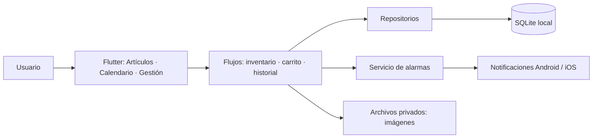

# Inventory App

Aplicación Flutter para llevar el inventario doméstico, registrar compras y
consumos, consultar caducidades y recibir recordatorios locales. Los datos se
guardan en el dispositivo; la aplicación no necesita una cuenta ni un servidor.

> Para una explicación interna completa de la arquitectura, los datos y los
> flujos, consulta [guia.md](./guia.md). La especificación de diseño está en
> [diseñoApp.md](./dise%C3%B1oApp.md) y el estado del proyecto en
> [avanceActual.MD](./avanceActual.MD).

## Requisitos

- Flutter 3.38.1 o posterior (el proyecto se validó con Flutter 3.47.1).
- Dart compatible con la restricción `sdk: ^3.13.1` de `pubspec.yaml`.
- Android Studio/Android SDK para ejecutar en Android.
- Xcode y macOS para compilar o ejecutar en iOS.

## Instalar y ejecutar

Desde la raíz del repositorio:

```bash
flutter pub get
flutter run
```

Para seleccionar un dispositivo conectado:

```bash
flutter devices
flutter run -d <device-id>
```

En Windows PowerShell, los mismos comandos usan la sintaxis habitual. Por
ejemplo:

```powershell
flutter pub get
flutter devices
flutter run -d f54ae66f
```

## Probar la aplicación

1. Abre **Artículos** y pulsa **+** para crear un artículo. Escribe el nombre,
   elige categoría y fecha de caducidad, indica la cantidad y guarda. La imagen
   es opcional.
2. Cuando se solicite el permiso, permite las notificaciones para recibir las
   alarmas de caducidad. El interruptor **Activar alarmas locales** controla
   esta preferencia por producto.
3. En **Artículos**, prueba la búsqueda y los filtros por categoría y estado;
   cambia el orden por nombre o por stock.
4. Pulsa el carrito de la parte superior para agregar los artículos que quieras
   reponer. En el carrito selecciona una tienda, completa los datos de compra y
   procesa el checkout.
5. Usa **Consumir** en una tarjeta para descontar unidades. El sistema descuenta
   primero el lote activo con la fecha de caducidad más próxima (FEFO).
6. Consulta **Calendario** para ver los días con lotes activos y toca una fecha
   para inspeccionar los artículos que caducan ese día.
7. En **Gestión**, administra productos, categorías y tiendas; abre el historial
   y revisa las estadísticas.

### Probar una notificación ahora mismo (modo depuración)

La alarma real se programa para las **9:00 a. m., hora local, del mismo día de
caducidad**. Si ya pasó esa hora, el sistema no programa una notificación
retroactiva. Para comprobar el permiso y la entrega sin esperar al próximo día:

1. Ejecuta la app en modo debug con `flutter run -d <device-id>`.
2. Abre **Gestión** y pulsa **Probar alarma (1 minuto)**.
3. Acepta el permiso del sistema si Android lo solicita y espera alrededor de un
   minuto. Se puede dejar la aplicación en segundo plano o bloquear la pantalla.

Este control solo aparece en compilaciones debug y envía un aviso de prueba
genérico. No cambia la fecha de caducidad ni la hora de las alarmas reales. Las
alarmas Android son inexactas para no requerir el permiso especial de alarmas
exactas, por lo que el sistema puede retrasarlas ligeramente. En algunos
fabricantes también pueden influir las restricciones de batería.

Si las notificaciones están desactivadas, habilítalas en **Ajustes de Android
> Aplicaciones > Inventory App > Notificaciones** y vuelve a pulsar el control
de prueba.

## Cómo se organiza la app



- **Artículos:** consulta existencias, filtra y ordena, registra artículos,
  agrega al carrito y consume stock.
- **Calendario:** agrupa los lotes activos por fecha de caducidad.
- **Gestión:** administra los datos básicos, muestra movimientos y estadísticas.
- **Persistencia:** SQLite conserva los registros y las imágenes se copian al
  almacenamiento privado de la app.

La aplicación implementa consumo FEFO, pero **no** contiene todavía edición de
productos ni sincronización en la nube. El carrito vive en memoria y se pierde
al cerrar la aplicación.

## Comprobaciones

```bash
flutter analyze
flutter test
flutter build apk --debug
```

Se ha probado la entrega de una notificación de prueba en un dispositivo
Android. La disponibilidad de iOS depende de permisos del sistema y requiere
validación en un dispositivo Apple.
