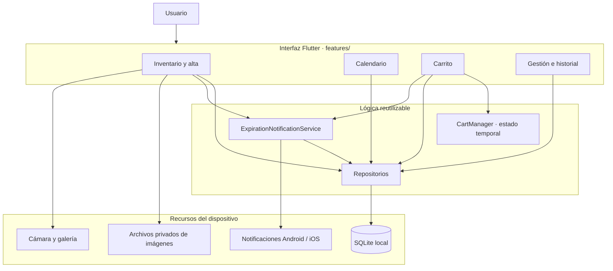
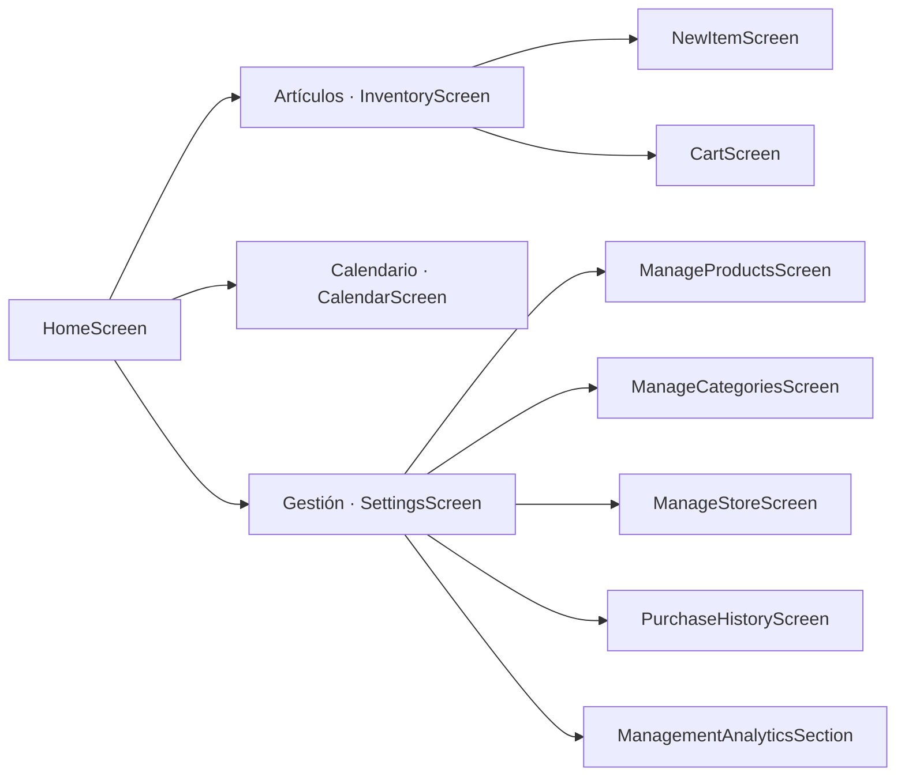
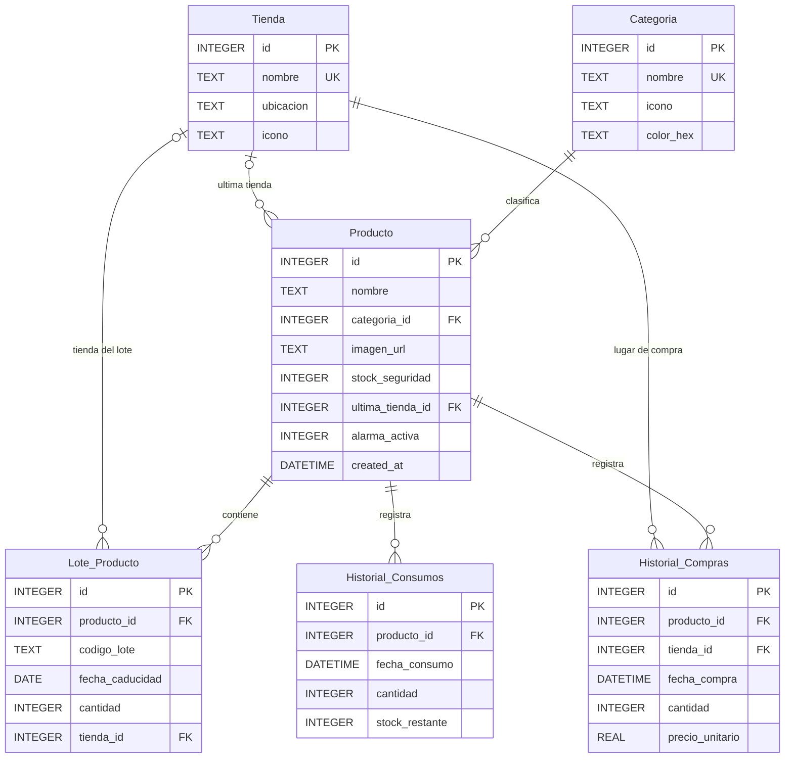
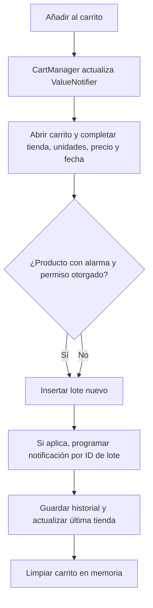
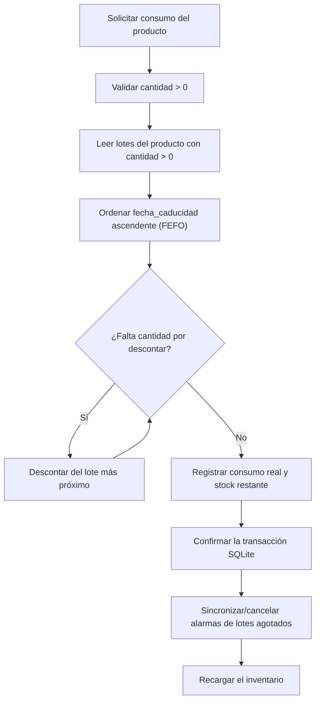
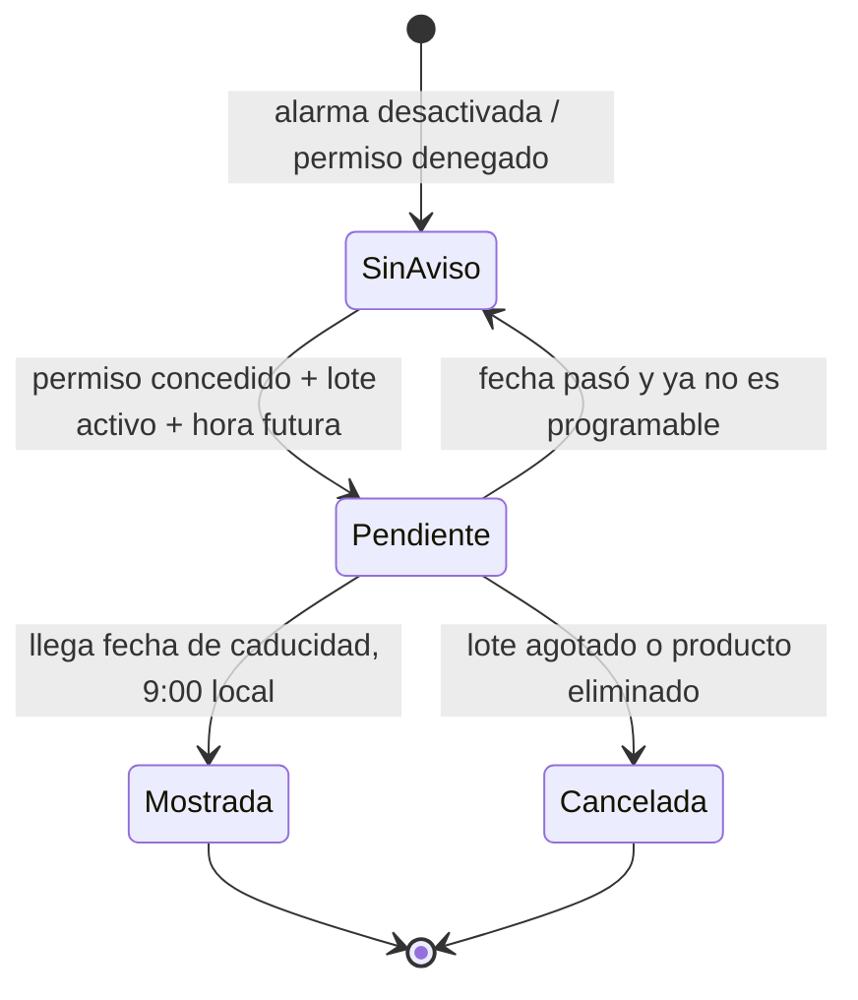
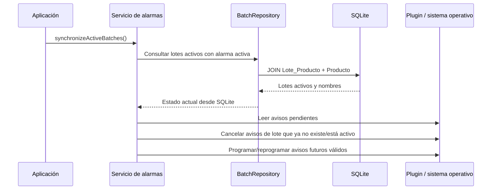
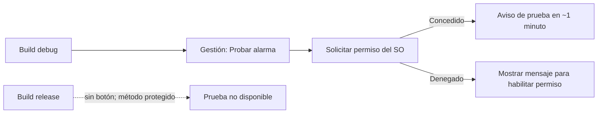

# Guía técnica completa de Inventory App

Esta guía explica cómo está organizada la aplicación, cómo se relacionan sus
datos y qué ocurre internamente durante las operaciones principales. Está
dirigida a quien necesite entender, presentar, mantener o ampliar el proyecto.
La guía rápida para instalar y usar la app está en [README.md](./README.md);
los requerimientos visuales están en [diseñoApp.md](./dise%C3%B1oApp.md).

---

## 1. Qué hace la aplicación

Inventory App permite registrar los productos de una despensa, administrar sus
existencias en lotes, consultar fechas de caducidad, guardar compras y consumos,
y recibir recordatorios locales. La información se almacena localmente en una
base SQLite y no requiere iniciar sesión ni conectarse a un backend.

### Capacidades disponibles

| Área | Qué permite hacer |
|---|---|
| Artículos | Ver productos, existencias, categoría y última tienda; buscar por nombre; filtrar y ordenar. |
| Alta | Crear el producto y su primer lote, registrar los detalles de compra y opcionalmente guardar una imagen. |
| Carrito | Preparar una reposición temporal y convertirla en lotes e historial de compra durante el checkout. |
| Consumo | Descontar stock priorizando lotes con caducidad más próxima (FEFO). |
| Calendario | Ver las fechas en que caducan lotes activos y consultar los lotes de un día. |
| Gestión | Administrar productos, categorías y tiendas, revisar el historial y consultar estadísticas. |
| Alarmas | Programar notificaciones locales por lote activo y reconciliarlas con la base de datos. |

### Lo que todavía no hace

- No sincroniza los datos con la nube ni entre dispositivos.
- El carrito vive en memoria y se pierde al cerrar la aplicación.
- No hay edición ni detalle completo de productos.
- El calendario no ofrece acciones para consumir o reponer directamente desde el detalle del día.
- No existe clasificación de tiendas por tipo.
- El aviso de caducidad funciona en Android/iOS; Android fue probado en un dispositivo. La validación de entrega en un iPhone queda pendiente.

---

## 2. Herramientas y dependencias

| Herramienta | Uso en el proyecto |
|---|---|
| Flutter / Dart | UI multiplataforma y lógica de la aplicación. Validación local: Flutter 3.47.1 y Dart 3.13.1. |
| Material y Cupertino | Componentes Flutter con colores y patrones visuales inspirados en iOS. |
| `sqflite` | Lectura, escritura y transacciones de SQLite. |
| `path` | Construcción de rutas de archivo portables. |
| `path_provider` | Ubicación privada persistente para imágenes y almacenamiento local. |
| `image_picker` | Captura desde cámara o selección de galería. |
| `table_calendar` | Calendario de fechas de caducidad. |
| `fl_chart` | Gráficas y representaciones estadísticas de Gestión. |
| `flutter_local_notifications` | Programación y cancelación de notificaciones locales. |
| `flutter_timezone` / `timezone` | Obtención de zona horaria local y programación con fecha/hora zonificada. |
| `google_fonts` | Tipografía del tema. |
| `badges`, `flutter_slidable`, `shimmer` | Dependencias declaradas; algunas capacidades aún no están conectadas a una pantalla. |

Las versiones y restricciones están en [pubspec.yaml](./pubspec.yaml) y las
versiones resueltas en [pubspec.lock](./pubspec.lock).

---

## 3. Cómo está organizada la aplicación

### 3.1 Arquitectura por capas



Una pantalla no consulta directamente el archivo SQLite. Solicita la operación
a un repositorio; este usa `DatabaseHelper` para abrir la base de datos. La
lógica de alarmas está concentrada en un servicio que coordina la base de datos
con el plugin nativo de notificaciones.

### 3.2 Navegación



`HomeScreen` conserva las tres vistas principales en una barra inferior. El
formulario, el carrito y las pantallas de administración se abren como rutas
encima de la navegación.

### 3.3 Mapa de carpetas y responsabilidades

```text
lib/
├── main.dart
├── core/
│   ├── database/database_helper.dart
│   ├── notifications/expiration_notification_service.dart
│   └── theme/app_theme.dart
├── data/
│   ├── models/
│   │   ├── category_model.dart
│   │   ├── product_model.dart
│   │   ├── product_batch_model.dart
│   │   └── store_model.dart
│   └── repositories/
│       ├── category_repository.dart
│       ├── product_repository.dart
│       ├── batch_repository.dart
│       ├── purchase_history_repository.dart
│       └── store_repository.dart
├── features/
│   ├── inventory/screens/
│   │   ├── home_screen.dart
│   │   ├── inventory_screen.dart
│   │   └── new_item_screen.dart
│   ├── calendar/screens/calendar_screen.dart
│   ├── cart/
│   │   ├── cart_manager.dart
│   │   └── screens/cart_screen.dart
│   └── settings/
│       ├── screens/
│       │   ├── settings_screen.dart
│       │   ├── manage_products_screen.dart
│       │   ├── manage_categories_screen.dart
│       │   ├── manage_store_screen.dart
│       │   └── purchase_history_screen.dart
│       └── widgets/management_analytics_section.dart
└── shared/widgets/
    ├── custom_sliver_app_bar.dart
    ├── docked_navigation_bar.dart
    └── product_card.dart
```

#### Archivos principales

| Archivo | Responsabilidad |
|---|---|
| `lib/main.dart` | Inicializa Flutter, presenta `MyApp` y lanza la sincronización inicial de notificaciones. |
| `lib/core/theme/app_theme.dart` | Colores, estilos y tema oscuro compartido. |
| `lib/core/database/database_helper.dart` | Abre `inventory_app.db`, crea tablas, configura llaves foráneas y migra versiones. |
| `lib/core/notifications/expiration_notification_service.dart` | Inicializa el plugin y la zona horaria, solicita permisos, programa avisos y reconcilia avisos por lote. |
| `lib/data/models/` | Convierte registros SQLite a objetos Dart y viceversa. |
| `lib/data/repositories/` | Encapsula consultas, transacciones y operaciones de persistencia. |
| `lib/features/inventory/screens/inventory_screen.dart` | Carga stock, aplica búsqueda/filtros y conecta las acciones de consumir y reponer. |
| `lib/features/inventory/screens/new_item_screen.dart` | Valida el alta, copia imagen, guarda producto/lote, historial y alarma. |
| `lib/features/cart/cart_manager.dart` | Mantiene los productos del carrito en un `ValueNotifier` en memoria. |
| `lib/features/cart/screens/cart_screen.dart` | Captura los datos de checkout y registra lotes y compras. |
| `lib/features/calendar/screens/calendar_screen.dart` | Agrupa lotes activos en días y muestra el detalle del día. |
| `lib/features/settings/screens/settings_screen.dart` | Entrada a administración, historial, estadísticas y prueba debug de notificación. |
| `lib/features/settings/widgets/management_analytics_section.dart` | Obtiene datos agregados y representa las estadísticas. |
| `lib/shared/widgets/` | Componentes visuales reutilizados. |

---

## 4. Persistencia y modelo de datos

### 4.1 Dónde se guardan los datos

- Base de datos: `inventory_app.db` en el directorio de bases de datos de la app.
- Imágenes: se copian al directorio privado de documentos bajo `product_images/`;
  la columna `Producto.imagen_url` guarda la ruta.
- Carrito: solo en memoria, usando `CartManager`; no forma parte de SQLite.
- Alarmas: se mantienen en el sistema de notificaciones local, con identificador
  basado en el ID del lote. La base SQLite continúa siendo la fuente de verdad
  para reconstruirlas.

### 4.2 Diagrama entidad-relación



### 4.3 Tablas y reglas de integridad

| Tabla | Propósito y reglas |
|---|---|
| `Categoria` | Catálogo único por `nombre`. Un producto no puede referenciar una categoría que se elimine (`ON DELETE RESTRICT`). |
| `Tienda` | Catálogo único por `nombre`; no guarda clasificación por tipo. |
| `Producto` | Datos generales y preferencia `alarma_activa` guardada como entero `0/1`. La tienda más reciente puede quedar nula si se elimina. |
| `Lote_Producto` | Fecha de caducidad y cantidad disponibles por partida; la cantidad no puede ser negativa. Borrar un producto borra sus lotes. |
| `Historial_Compras` | Fecha, cantidad, precio unitario y tienda. La tienda tiene `ON DELETE RESTRICT` para conservar la trazabilidad. |
| `Historial_Consumos` | Cantidad efectivamente descontada y stock total resultante; cantidad debe ser positiva y stock restante no negativo. |

SQLite activa `PRAGMA foreign_keys = ON`. Índices implementados:

- `idx_lote_caducidad(fecha_caducidad, cantidad)` para consultas por lote y fecha.
- `idx_producto_categoria(categoria_id)` para relaciones por categoría.
- `idx_historial_consumos_fecha(fecha_consumo)` para series de consumo por fecha.

### 4.4 Evolución del esquema

`DatabaseHelper.versionDB` está en versión 4:

1. La versión 2 incorpora `Historial_Consumos`.
2. La migración de versión 4 elimina la columna experimental `Tienda.tipo` si
   existe, preservando las tiendas y sus transacciones.

El esquema de la base se define en
[`database_helper.dart`](./lib/core/database/database_helper.dart). No se debe
alterar una tabla directamente sin incrementar la versión y preparar una
migración compatible con bases ya instaladas.

---

## 5. Modelos y repositorios

### Modelos

- `CategoryModel`: ID y nombre de categoría, con campos opcionales para icono/color.
- `StoreModel`: ID, nombre, ubicación e icono.
- `ProductModel`: nombre, categoría, imagen, stock de seguridad, última tienda,
  preferencia de alarma y datos consultados de categoría/tienda. El modelo traduce
  `isAlarmActive` a `alarma_activa` (`1` o `0`).
- `ProductBatchModel`: ID del lote, ID de producto, código opcional, fecha,
  cantidad, tienda y nombre del producto asociado en consultas.

### Repositorios

| Repositorio | Operaciones representativas |
|---|---|
| `CategoryRepository` | Insertar, listar, obtener/crear la categoría predeterminada y eliminar respetando referencias. |
| `StoreRepository` | Insertar, listar, consultar por ID y eliminar; las compras relacionadas impiden el borrado. |
| `ProductRepository` | Crear producto con lote inicial en transacción, consultar productos con stock agregado, consumir FEFO y borrar producto. |
| `BatchRepository` | Insertar lote, consultar lotes activos, obtener lotes de productos con alarmas y verificar preferencia de alarma. |
| `PurchaseHistoryRepository` | Registrar compra y tienda reciente, unir movimientos para el historial y consultar agregados de estadísticas. |

---

## 6. Flujos principales explicados

### 6.1 Crear un artículo

```mermaid
sequenceDiagram
    actor U as Usuario
    participant UI as NewItemScreen
    participant N as ExpirationNotificationService
    participant P as ProductRepository
    participant DB as SQLite
    participant H as PurchaseHistoryRepository

    U->>UI: Completa producto y lote inicial
    UI->>UI: Valida nombre y cantidad
    opt Alarma activada en Android/iOS
      UI->>N: Solicita permiso local
      N-->>UI: Permiso concedido / denegado
    end
    UI->>P: Inserta producto y lote inicial
    P->>DB: INSERT Producto + INSERT Lote_Producto (transacción)
    DB-->>P: productId y batchId
    opt Tienda seleccionada
      UI->>H: Registrar compra inicial
      H->>DB: INSERT Historial_Compras + actualizar última tienda (transacción)
    end
    opt Permiso concedido y 9:00 a.m. aún futura
      UI->>N: Programar alarma para batchId
      N-->>UI: Programación aceptada
    end
    UI-->>U: Cierra el formulario; avisa si la alarma no se programó
```

El producto y el lote inicial se guardan juntos, pero el registro de compra se
realiza después en una transacción separada. Por tanto, si falla la escritura de
historial después de crear el producto, puede quedar creado el producto/lote sin
la compra asociada.

Al abrir el formulario, la app carga las categorías y tiendas desde SQLite. Si
no hay categorías o solo existe una, agrega las categorías predeterminadas que
no encuentre; si la tabla de tiendas está vacía, agrega tiendas predeterminadas.
El formulario elige inicialmente el primer resultado de cada catálogo. Si hay
imagen, se copia al directorio privado antes de guardar la ruta en el producto;
si el alta falla antes de persistir el producto, se intenta borrar esa copia.

### 6.2 Agregar al carrito y registrar una compra



El checkout itera los artículos uno a uno. Para cada artículo crea un lote y,
después, registra el movimiento de compra. No existe una transacción global que
incluya todos los artículos ni una transacción común al lote y al historial.
Actualmente, el formulario del carrito convierte una cantidad no numérica a
`1` y un precio no numérico a `0`; es una limitación pendiente de validación.
El carrito agrupa las unidades por producto: volver a añadir el mismo producto
incrementa su cantidad. El estado usa `ValueNotifier`, de modo que el badge y la
vista se actualizan al cambiarlo. Esta estructura singleton vive solamente
mientras el proceso de la app permanece activo.

### 6.3 Consumir existencias con FEFO



El descuento de lotes y la inserción en `Historial_Consumos` ocurren dentro de
la misma transacción. Si el stock disponible es inferior a la cantidad
solicitada, se consume lo que existe y el historial registra la cantidad
efectivamente descontada. Si no se logra descontar ninguna unidad, no se crea un
evento.

El consumo normal desde la tarjeta descuenta una unidad. La función del
repositorio acepta una cantidad mayor, y puede agotar un lote y continuar con
el siguiente.

### 6.4 Historial unificado

`PurchaseHistoryRepository.getPurchaseHistory()` combina con `UNION ALL`:

- `Historial_Compras`, que incluye tienda y precio.
- `Historial_Consumos`, que incluye `stock_restante`.

La pantalla los ordena por fecha descendente. Un consumo se presenta como
agotamiento cuando `stock_restante == 0`; si queda cantidad positiva, aparece
como consumo parcial. Las tarjetas usan la imagen persistida si puede cargarse,
y un ícono predeterminado si no hay imagen disponible.

### 6.5 Estadísticas de Gestión

Las estadísticas se consultan al entrar a Gestión y se presentan debajo del
acceso al historial:

| Vista | Fuente y cálculo |
|---|---|
| Consumo | `Historial_Consumos`, suma de unidades por día en los últimos siete días (incluye hoy). |
| Tiendas habituales | Historial completo de compras agrupado por tienda: unidades, proporción del total e importe calculado con precio unitario. |
| Agotamiento de stock | Total de eventos de consumo con `stock_restante = 0` frente a eventos con stock restante positivo. |

La clasificación por tienda se basa solamente en el nombre de la tienda: no
existe tipo supermercado/mercado/local. Si no hay datos se muestran estados
vacíos; si falla la carga, se ofrece reintentar. Hay espacio desplazable bajo la
última gráfica para no ocultarla con la barra inferior.

---

## 7. Alarmas locales de caducidad

### 7.1 Regla y ciclo de vida

- La preferencia está en el producto: `alarma_activa`.
- Se programa un aviso individual para cada lote con cantidad mayor que cero de
  un producto con alarma activa.
- El horario es **9:00 a. m. local, el mismo día de caducidad**.
- La fecha almacenada es fecha calendario, sin hora; se convierte a las 9:00 a.
  m. en la zona horaria local del dispositivo.
- Si la hora ya pasó o la fecha es anterior a hoy, no se envía un aviso
  retroactivo.
- Se usa el ID del lote como identificador de notificación; eso permite
  reemplazar/reprogramar el aviso de ese lote sin generar duplicados.
- Al iniciar la app y después de consumir o eliminar un producto, el servicio
  compara lotes activos de SQLite con los avisos pendientes y cancela los que
  ya no corresponden.
- Si se deniega el permiso o hay un error programando, el guardado del artículo
  o de la compra se conserva y la interfaz informa que el aviso no quedó activo.



### 7.2 Sincronización en segundo plano



### 7.3 Permisos y configuración Android

El plugin está inicializado sin solicitar permiso automáticamente al arranque.
El permiso se pide cuando se activa una alarma durante el alta/check-out o
cuando se utiliza la prueba de depuración. El manifiesto Android declara la
recepción del arranque y los receivers para restaurar alarmas. Gradle configura
desugaring, necesario para la versión actual del plugin.

Android usa `AndroidScheduleMode.inexactAllowWhileIdle`: no requiere pedir al
usuario acceso a alarmas exactas, pero puede entregar el aviso con retraso.
Algunos fabricantes imponen restricciones adicionales de batería; el usuario
puede necesitar permitir actividad en segundo plano.

### 7.4 Prueba rápida, solo para depuración

En builds debug, Gestión muestra **Probar alarma (1 minuto)**. El botón solicita
permiso y programa un mensaje genérico a un minuto. La llamada está protegida
por `kDebugMode`, igual que el control de interfaz, y no cambia la regla de las
9:00 a. m. ni necesita crear un artículo.



En Android, se validó la notificación de prueba en un dispositivo conectado.
La prueba verifica el permiso, la configuración del plugin y la entrega del
sistema; no sustituye una prueba que espere hasta la fecha real de caducidad.

---

## 8. Interfaz y reglas de uso

### Artículos

- Busca por nombre; se normalizan espacios externos y mayúsculas.
- El panel **Filtrar y ordenar** permite elegir categoría, estado y orden.
- "En stock" significa stock mayor que cero; "Stock bajo" significa stock
  positivo menor o igual al umbral de seguridad; "Agotados" significa cero.
- El estado de la tarjeta depende del stock; aún no clasifica visualmente por
  días hasta caducidad.
- Las imágenes no son obligatorias.
- El formulario requiere nombre y cantidad inicial mayor que cero. El umbral de
  stock de seguridad se fija en `1`; precio y tienda no tienen validación
  obligatoria.

### Calendario

El calendario agrupa los lotes activos por día de caducidad. Los días con uno o
más lotes reciben un marcador y, al seleccionarlos, se abre un panel inferior
con sus productos y cantidades. Solo se muestran lotes con cantidad mayor que
cero.

### Gestión de productos, categorías y tiendas

- Las categorías usadas por productos no se pueden borrar mientras exista una
  referencia.
- Las tiendas con compras históricas no se pueden borrar, para preservar la
  relación de compra.
- Borrar un producto elimina también sus lotes e historiales relacionados
  debido a las llaves foráneas `ON DELETE CASCADE`.
- Las estadísticas agrupan tiendas por su registro existente, no por una
  clasificación editable.

### Imágenes

El alta pide una foto opcional con cámara o galería. El archivo seleccionado se
copia a `product_images` en el almacenamiento privado de la app y se guarda la
ruta en SQLite. Esto conserva la imagen fuera de la ubicación temporal del
selector.

---

## 9. Ejecución, pruebas y depuración

### Preparar y abrir

```bash
flutter pub get
flutter devices
flutter run -d <device-id>
```

### Validar el proyecto

```bash
dart analyze
flutter test
flutter build apk --debug
```

Pruebas enfocadas actuales:

```bash
flutter test test/widget_test.dart test/expiration_notification_service_test.dart
```

Las pruebas de fecha de alarma cubren:

1. Programación a las 9:00 a. m. de la fecha de caducidad.
2. No adelantar el aviso al día anterior.
3. No programar si ya pasó la hora de las 9:00 el día de vencimiento.
4. No programar fechas pasadas.

Las pruebas de widget/modelo cubren filtros y orden del inventario, campos de
tienda sin clasificación, errores de guardado de tienda, estructura y
validaciones del formulario, placeholder de imagen y presentación de consumo
parcial/agotamiento. Son pruebas de UI/lógica aislada, no una batería completa
de pruebas de repositorios contra SQLite real.

### Diagnóstico de notificaciones

1. Confirma que estás ejecutando una compilación Android debug.
2. Revisa permiso de notificaciones en Ajustes de Android para la aplicación.
3. En Gestión, pulsa **Probar alarma (1 minuto)**.
4. Si Android no muestra el aviso, revisa el canal "Caducidad de productos",
   No molestar y restricciones de batería.
5. Para alarmas de producción, usa una fecha futura cuyo horario local de las
   9:00 a. m. aún no haya pasado. Espera el día correspondiente.

El control debug puede no aparecer en un APK release: por diseño, solo se añade
cuando `kDebugMode` es verdadero.

---

## 10. Limitaciones técnicas y oportunidades de mejora

| Tema | Comportamiento actual | Próximo paso posible |
|---|---|---|
| Atomicidad de checkout | Cada lote y cada historial se guardan de manera separada; no hay transacción para todo el carrito. | Mover el checkout a una operación de repositorio transaccional. |
| Validación de checkout | Cantidad y precio inválidos se reemplazan por `1` y `0`. | Validar y mostrar errores antes de guardar. |
| Persistencia del carrito | Solo memoria. | Decidir si se debe restaurar después de cerrar la app. |
| Alta e historial | Producto/lote inicial e historial se guardan en transacciones distintas. | Unificar si se requiere consistencia total de compra inicial. |
| Alarmas | Android usa horario inexacto; no se probaron todas las políticas de OEM ni iOS. | Verificar iOS y documentar excepciones por fabricante. |
| Entrega de alarma vencida | No hay notificación retroactiva después de las 9:00 a. m. | Definir si se necesita otra política de recuperación. |
| Catálogo | No hay edición de producto ni stock de seguridad configurable. | Añadir formulario de edición y validación de referencias. |
| Pruebas | Predominan pruebas de lógica de UI/modelos; no se cubren repositorios SQLite de punta a punta. | Introducir base en memoria/temporal y pruebas transaccionales. |
| Sincronización | Todo es local a un dispositivo. | Diseñar identidad, autenticación y política de conflictos antes de sincronizar. |

---

## 11. Glosario

| Término | Explicación |
|---|---|
| Lote | Entrada de unidades de un producto con su propia fecha de caducidad. |
| FEFO | *First Expired, First Out*: consumir primero el lote que vence antes. |
| Stock total | Suma de cantidades de lotes activos de un producto. |
| Consumo parcial | Evento de consumo cuyo stock restante es mayor que cero. |
| Agotamiento | Evento de consumo cuyo stock restante queda en cero. |
| Reconciliación | Comparar notificaciones programadas con los lotes activos de SQLite y corregir las diferencias. |
| `alarma_activa` | Preferencia almacenada por producto como `0` (inactiva) o `1` (activa). |
| `batchId` | ID SQLite del lote; se usa como ID determinista de su notificación. |
